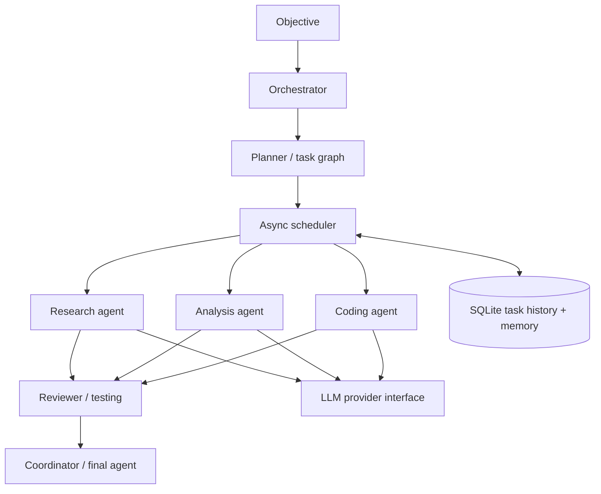

# Multi-Agent System

A modular Python 3.12+ starter for async multi-agent orchestration. It includes a dependency-aware DAG scheduler, bounded concurrency and retries, typed Pydantic models, a replaceable agent registry, mock and optional OpenAI providers, SQLite task history and project memory, a permission-aware tool registry, JSON logs, example workflows, tests, and an optional FastAPI read API.

## Requirements

- Python 3.12+
- `uv`
- An OpenAI API key only when using the real provider (`LLM_PROVIDER=openai`)

## Setup

```bash
uv sync --extra dev
cp .env.example .env
uv run mas research
uv run mas coding
uv run mas complex
uv run pytest
uv run ruff check .
```

For real model calls:

```bash
uv add --optional openai openai
```

Set `LLM_PROVIDER=openai` and `OPENAI_API_KEY` in `.env`. The mock provider is the default and makes local tests/demos work without paid API calls.

## API server

```bash
uv sync --extra api
uv run uvicorn multi_agent.api:app --reload
```

Endpoints: `GET /health`, `GET /agents`, `GET /tasks/history`.

## Architecture



## Adding an agent

Implement the `Agent` protocol in `agents/base.py` (`plan`, `execute`, `review`, `communicate`, `cancel`) and register an instance in `main.py`. Replace `SpecialistAgent` with a dedicated class when an agent needs unique behavior.

## Adding a tool

Create a Pydantic input model, an async handler, and register a `ToolDefinition` in `ToolRegistry`. Declare required permissions and a timeout. The registry validates inputs, checks grants, and wraps execution in `asyncio.wait_for`. Do not expose arbitrary shell execution to model-generated input.

## Reliability and security notes

- DAG validation rejects cycles and unknown dependencies.
- Scheduler uses concurrency limits, task timeouts, bounded retries with exponential backoff, persistent task results, and dependency failure blocking.
- SQLite is suitable for a local single-process starter; use PostgreSQL and a migration layer for multi-worker deployment.
- Tool permission checks are implemented in the registry but need to be connected to each production tool call path.
- The OpenAI provider is optional. Mock mode does not make network calls.
- The included review agent interface is a starter hook, not a full adversarial quality gate. Production review should use structured verdicts, bounded revision loops, and independent evidence checks.
- The demo workflows exercise orchestration but do not run generated code or unrestricted shell commands. A secure execution tool should use a container/VM sandbox with CPU, memory, filesystem, network, and wall-clock limits.
- SQLite memory retrieval is transparent keyword matching; embeddings are intentionally optional.
- `uv.lock` should be generated and committed in your environment with `uv lock` for reproducible deployment.

## Current scope

This is an extensible starter, not a claim of production certification. Distributed queues, multi-user authentication, PostgreSQL, advanced tracing/token accounting, checkpoint recovery, and enforced human approval gates are extension points.
